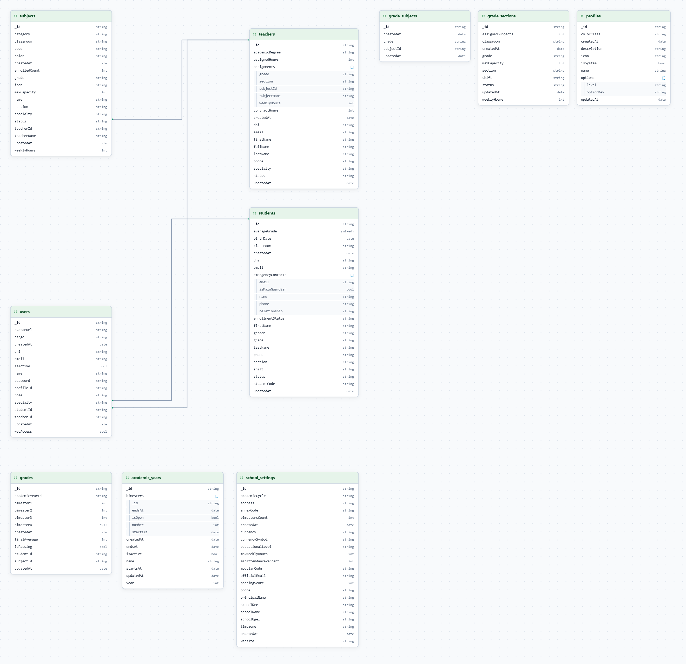
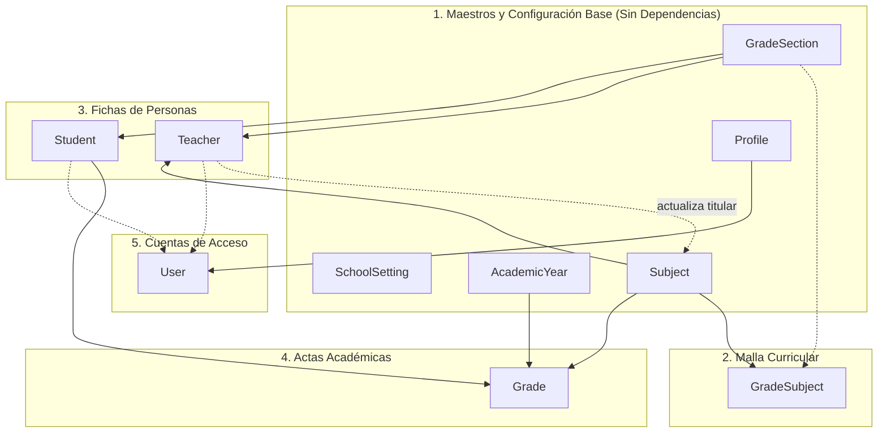

# Diccionario de Datos, Entidades y Relaciones (MongoDB / Mongoose) 🍃

Documento oficial de referencia del modelo de datos para el sistema **EduPortal**. Describe cada colección, sus propiedades en inglés con su traducción y explicación en castellano, los tipos de datos y el mapa de relaciones entre entidades.

---

## 🗺️ Diagrama Entidad - Relación (Modelo Lógico NoSQL)

### 📸 Modelo Visual de Colecciones (MongoDB Compass / Schema Visualizer)

### 📊 Diagrama Estructural Completo de Entidades (Mermaid)

```mermaid
erDiagram
    subjects {
        string _id PK
        string code UK
        string name
        string category
        string specialty
        string grade
        string section
        string classroom
        string teacherId FK
        string teacherName
        int weeklyHours
        int enrolledCount
        int maxCapacity
        string icon
        string color
        string status
        date createdAt
        date updatedAt
    }

    grade_subjects {
        string _id PK
        string grade
        string subjectId FK
        date createdAt
        date updatedAt
    }

    grade_sections {
        string _id PK
        string grade
        string section
        string classroom
        int maxCapacity
        string shift
        string status
        int assignedSubjects
        int weeklyHours
        date createdAt
        date updatedAt
    }

    profiles {
        string _id PK
        string name
        string description
        string icon
        string colorClass
        bool isSystem
        date createdAt
        date updatedAt
    }

    teachers {
        string _id PK
        string firstName
        string lastName
        string fullName
        string dni UK
        string email UK
        string phone
        string specialty
        string academicDegree
        int contractHours
        int assignedHours
        string status
        date createdAt
        date updatedAt
    }

    students {
        string _id PK
        string studentCode UK
        string firstName
        string lastName
        string dni UK
        string email
        string phone
        date birthDate
        string gender
        string grade
        string section
        string classroom
        string shift
        string enrollmentStatus
        string status
        float averageGrade
        date createdAt
        date updatedAt
    }

    users {
        string _id PK
        string name
        string email UK
        string dni UK
        string password
        string role
        string cargo
        string specialty
        string profileId FK
        string teacherId FK
        string studentId FK
        bool webAccess
        bool isActive
        string avatarUrl
        date createdAt
        date updatedAt
    }

    grades {
        string _id PK
        string studentId FK
        string subjectId FK
        string academicYearId FK
        int bimester1
        int bimester2
        int bimester3
        int bimester4
        int finalAverage
        bool isPassing
        date createdAt
        date updatedAt
    }

    academic_years {
        string _id PK
        int year UK
        string name
        date startsAt
        date endsAt
        bool isActive
        date createdAt
        date updatedAt
    }

    school_settings {
        string _id PK
        string schoolName
        string modularCode
        string annexCode
        string educationalLevel
        string schoolUgel
        string schoolDre
        string address
        string phone
        string officialEmail
        string website
        string principalName
        int passingScore
        int minAttendancePercent
        int maxWeeklyHours
        string currency
        string currencySymbol
        string timezone
        string academicCycle
        int bimestersCount
        date createdAt
        date updatedAt
    }

    teachers ||--o{ subjects : "teacherId (titular)"
    users ||--o| teachers : "teacherId"
    users ||--o| students : "studentId"
    profiles ||--o{ users : "profileId"
    students ||--o{ grades : "studentId"
    subjects ||--o{ grades : "subjectId"
    academic_years ||--o{ grades : "academicYearId"
    subjects ||--o{ grade_subjects : "subjectId"
```

---

## 🪜 Orden Lógico de Creación de Entidades (Secuencia de Poblado)

Para poblar o inicializar la base de datos sin errores de integridad referencial ni identificadores (`_id`) huérfanos, las 10 entidades deben crearse respetando este **orden topológico de dependencias**:

### Tabla de Secuencia de Poblado

| Paso | Entidad / Colección | Dependencias requeridas | Razón técnica del orden |
| :---: | :--- | :--- | :--- |
| **1°** | **`SchoolSetting`** (`school_settings`) | **Ninguna** | Identidad escolar (nombre, código modular, UGEL, director). No referencia a nadie. |
| **2°** | **`Profile`** (`profiles`) | **Ninguna** | Catálogo de roles y matriz de permisos RBAC (`FULL` / `READ_ONLY`). Necesario para validar accesos. |
| **3°** | **`AcademicYear`** (`academic_years`) | **Ninguna** | Calendario escolar oficial (año activo y fechas de los 4 bimestres). Requerido antes de registrar cualquier nota. |
| **4°** | **`GradeSection`** (`grade_sections`) | **Ninguna** | Aulas físicas y vacantes escolares (1° A, 1° B...). Requerido para saber dónde matricular alumnos y asignar profesores. |
| **5°** | **`Subject`** (`subjects`) | **Ninguna** | Catálogo oficial de cursos normados (Matemática, Comunicación...). Debe existir antes de armar la malla o contratar docentes para la materia. |
| **6°** | **`GradeSubject`** (`grade_subjects`) | Requiere `Subject` (y grado de `GradeSection`) | Tabla puente de la malla curricular que define qué cursos se dictan en cada grado escolar. |
| **7°** | **`Teacher`** (`teachers`) | Requiere `GradeSection` y `Subject` | Ficha del docente con sus asignaciones de aula (`TeacherAssignment`). Una asignación exige saber qué aula y qué curso dicta. *(Tras crearse, se actualiza el docente titular en `Subject`)*. |
| **8°** | **`Student`** (`students`) | Requiere `GradeSection` | Ficha del alumno matriculado en un grado y sección física existente. |
| **9°** | **`Grade`** (`grades`) | Requiere `Student`, `Subject` y `AcademicYear` | Acta de calificaciones por competencias. Conecta al alumno con el curso calificado en el año lectivo activo. |
| **10°** | **`User`** (`users`) | Requiere `Profile` y opcionalmente `Teacher` o `Student` | Cuentas para autenticación (login con email y JWT). Se crean al final porque vinculan el `profileId` obligatorio y el `teacherId` o `studentId` de las personas ya registradas. |

---

## 🏛️ Filosofía de Modelado: Referencias vs. Documentos Embebidos

En este backend con MongoDB y Mongoose combinamos lo mejor de ambos mundos:

1. **Documentos Embebidos (Subdocumentos)**: Se usan cuando los datos pertenecen exclusivamente a la entidad padre y siempre se leen juntos:
   * Los **contactos de emergencia** viven dentro de cada `Student`.
   * Las **asignaciones de aulas** viven dentro de cada `Teacher`.
   * El **historial de cambios de profesor** vive dentro de cada `Subject`.
   * Los **4 bimestres** viven dentro de cada `AcademicYear`.
   * Las **opciones de permisos** viven dentro de cada `Profile`.
2. **Referencias por ID (Relaciones / Llaves Foráneas)**: Se usan para conectar entidades principales independientes (`User` ↔ `Profile`, `Grade` ↔ `Student` + `Subject` + `AcademicYear`, `GradeSubject` ↔ `Subject`). Permiten integridad de datos y consultas mediante `.populate()`.

---

## 📋 Detalle de Colecciones y Propiedades (En Orden Lógico de Creación)

---

### 1. `school_settings` (Ajustes Institucionales Clave / Valor)
Almacena configuraciones del colegio en documentos JSON flexibles. Debe existir en primer lugar para dotar de identidad institucional al sistema.

| Propiedad (Inglés) | Tipo de Dato | Traducción / Descripción en Castellano |
| :--- | :--- | :--- |
| `_id` | `String` | **Clave de configuración**: Identificador clave (ej. `"school"` o `"rules"`). |
| `value` | `Object / Mixed`| **Valor de configuración**: Objeto JSON con el nombre del colegio, DRE, UGEL, dirección, director, etc. |
| `updatedAt` | `Date` | **Fecha de última modificación**: Timestamp de la última actualización. |

---

### 2. `profiles` (Perfiles y Matriz de Permisos RBAC)
Define los perfiles de acceso (Super Admin, Administrador, Director, Docente, Alumno) y qué módulos pueden ver o editar.

| Propiedad (Inglés) | Tipo de Dato | Traducción / Descripción en Castellano |
| :--- | :--- | :--- |
| `_id` | `String` | **ID del perfil**: Identificador del perfil (ej. `"prof-admin"`, `"prof-docente"`). |
| `name` | `String` | **Nombre del perfil**: Nombre legible (ej. `"Perfil Docente de Secundaria"`). |
| `description` | `String` | **Descripción**: Explicación de los alcances y responsabilidades del perfil. |
| `icon` | `String` | **Icono**: Nombre del icono Material (ej. `"shield"`, `"school"`, `"backpack"`). |
| `colorClass` | `String` | **Clase de color**: Clase visual CSS (ej. `"prof-blue"`, `"prof-green"`, `"prof-teal"`). |
| `isSystem` | `Boolean` | **Perfil del sistema**: Si es `true`, está protegido y no puede ser deshabilitado. |
| `status` | `String` | **Estado del perfil**: `"ACTIVE"` o `"INACTIVE"` (soft-delete mediante flag). |
| `options` | `Array` | **Opciones/Permisos**: Lista de submódulos autorizados (subdocumentos embebidos). |
| `options.optionKey`| `String` | **Clave del módulo**: Nombre del módulo (`"students"`, `"grades"`, `"dashboard"`). |
| `options.level` | `String` | **Nivel de permiso**: `"FULL"` (Control total) o `"READ_ONLY"` (Solo lectura). |
| `createdAt` | `Date` | **Fecha de registro**: Cuándo se creó el perfil. |

**🔗 Relaciones:**
* Tiene muchos `User` asociados que heredan esta matriz de permisos.

---

### 3. `academic_years` (Año Lectivo y Bimestres MINEDU)
Configuración del calendario escolar oficial y apertura de bimestres para el registro de notas.

| Propiedad (Inglés) | Tipo de Dato | Traducción / Descripción en Castellano |
| :--- | :--- | :--- |
| `_id` | `String` | **ID del año escolar**: Identificador único (ej. `"ay-2026"`). |
| `year` | `Number` | **Año calendario**: Año lectivo escolar (ej. `2026`). Único. |
| `name` | `String` | **Nombre oficial**: Denominación del año (ej. `"Año Escolar 2026"`). |
| `startsAt` | `Date` | **Fecha de inicio**: Primer día del año escolar (ej. `2026-03-09`). |
| `endsAt` | `Date` | **Fecha de clausura**: Último día del año escolar (ej. `2026-12-19`). |
| `isActive` | `Boolean` | **Año lectivo activo**: Solo un año puede ser `true` a la vez en la institución. |
| `bimesters` | `Array` | **Bimestres escolares**: Lista de los 4 bimestres (subdocumentos embebidos). |
| `bimesters.number` | `Number` | **Número de bimestre**: Entero del `1` al `4` (I, II, III o IV Bimestre). |
| `bimesters.startsAt` | `Date` | **Inicio del bimestre**: Fecha en que empieza el periodo evaluativo. |
| `bimesters.endsAt` | `Date` | **Fin del bimestre**: Fecha en que culmina el periodo evaluativo. |
| `bimesters.isOpen` | `Boolean` | **Bimestre abierto**: Si es `true`, los docentes pueden registrar notas. Si es `false`, está cerrado. |

---

### 4. `grade_sections` (Aulas, Grados y Secciones)
Representa cada salón de clases físico (10 aulas base de secundaria: de 1° a 5°, secciones A y B).

| Propiedad (Inglés) | Tipo de Dato | Traducción / Descripción en Castellano |
| :--- | :--- | :--- |
| `_id` | `String` | **ID de sección**: Identificador de aula (ej. `"sec-1-a"`, `"sec-5-b"`). |
| `grade` | `String` | **Grado escolar**: Grado (ej. `"1° Secundaria"`, `"2° Secundaria"`). |
| `section` | `String` | **Sección**: Letra de sección (`"A"` o `"B"`). |
| `classroom` | `String` | **Nombre del aula**: Denominación física (ej. `"Aula 101"`, `"Aula 502"`). |
| `maxCapacity` | `Number` | **Capacidad máxima**: Vacantes oficiales (por defecto 30 alumnos por aula). |
| `shift` | `String` | **Turno**: Horario de clases (`"MAÑANA"` o `"TARDE"`). |
| `status` | `String` | **Estado del aula**: `"ACTIVE"` (Operativa) o `"INACTIVE"` (Cerrada temporalmente). |
| `assignedSubjects`| `Number` | **Cursos asignados**: Total de materias del plan de estudios asignadas a esta aula. |
| `weeklyHours` | `Number` | **Horas lectivas semanales**: Suma de horas semanales de clase en el aula (35h). |

**🔗 Relaciones:**
* Agrupa a los estudiantes de `Student` que coinciden en `(grade, section)`.
* Sus vacantes disponibles se calculan en vivo: `availableSlots = maxCapacity - enrolledStudents`.

---

### 5. `subjects` (Cursos Curriculares CNEB - Modelo `Subject`)
Las 11 áreas curriculares normadas por el Ministerio de Educación del Perú (JER - 35 horas semanales). En código TypeScript se modela como `Subject` y su colección en MongoDB es `subjects`. Ruta API: `/api/subjects`.

| Propiedad (Inglés) | Tipo de Dato | Traducción / Descripción en Castellano |
| :--- | :--- | :--- |
| `_id` | `String` | **ID del curso**: Identificador oficial (ej. `"cur-mat-100"`, `"cur-com-100"`). |
| `code` | `String` | **Código del curso**: Código curricular único (ej. `"MAT-100"`, `"COM-100"`). |
| `name` | `String` | **Nombre del curso**: Nombre oficial (ej. `"Matemática"`, `"Comunicación"`). |
| `category` | `String` | **Área formativa**: Área macro (`"CIENCIAS"`, `"HUMANIDADES"`, `"TECNOLOGÍA"`, etc.). |
| `specialty` | `String` | **Especialidad requerida**: Especialidad que debe poseer el profesor para dictarla. |
| `grade` | `String` | **Grados de alcance**: Alcance educativo (ej. `"Secundaria (1° a 5°)"`). |
| `section` | `String` | **Sección**: Identificador de aula o `"Común"`. |
| `classroom` | `String` | **Ambiente físico**: Aula o laboratorio donde se imparte (ej. `"Aula Oficial"`). |
| `teacherId` | `String? (Ref)`| **ID docente titular**: Referencia al profesor titular en la colección `teachers`. |
| `teacherName` | `String` | **Nombre docente titular**: Nombre desnormalizado para consultas instantáneas. |
| `weeklyHours` | `Number` | **Horas semanales**: Horas normadas por el MINEDU (ej. 5 horas para Matemática). |
| `enrolledCount` | `Number` | **Alumnos inscritos**: Total de alumnos que cursan la materia. |
| `maxCapacity` | `Number` | **Capacidad máxima**: Límite de vacantes permitidas. |
| `icon` | `String` | **Icono**: Emoji o glifo representativo (ej. `📐`, `📖`, `🧪`, `⚽`). |
| `color` | `String` | **Color distintivo**: Código hexadecimal (ej. `"#2563eb"`, `"#059669"`). |
| `status` | `String` | **Estado curricular**: `"ACTIVE"` (Vigente) o `"INACTIVE"` (Histórico). |
| `teacherHistories` | `Array` | **Historial de cátedra**: Registro de auditoría (subdocumentos embebidos). |
| `teacherHistories.previousTeacher` | `String?` | **Docente anterior**: Nombre del profesor que dejó la cátedra. |
| `teacherHistories.newTeacher` | `String` | **Nuevo docente titular**: Nombre del profesor asignado. |
| `teacherHistories.assignedBy` | `String` | **Autorizado por**: Usuario directivo que autorizó el cambio. |
| `teacherHistories.reason` | `String?` | **Motivo del cambio**: Justificación administrativa del cambio de cátedra. |
| `teacherHistories.assignedAt` | `Date` | **Fecha del cambio**: Fecha y hora exacta de la asignación. |

**🔗 Relaciones:**
* Apunta al docente titular `Teacher` a través de `teacherId`.
* Es calificada en `Grade` (`grade.subjectId = subject._id`).
* Es asignada a los grados escolares en `grade_subjects` (`grade_subject.subjectId = subject._id`).

---

### 6. `grade_subjects` (Malla Curricular por Grado Escolar - Modelo `GradeSubject`)
Tabla de relación que define qué cursos (`Subject`) pertenecen al plan de estudios de cada grado. En código se modela como `GradeSubject` (colección `grade_subjects`). Rutas API: `/api/grade-sections/subjects`.

| Propiedad (Inglés) | Tipo de Dato | Traducción / Descripción en Castellano |
| :--- | :--- | :--- |
| `_id` | `String` | **ID de asignación**: Identificador único generado. |
| `grade` | `String` | **Grado escolar**: Grado al que pertenece el plan de estudios (ej. `"1° Secundaria"`). |
| `subjectId` | `String (Ref)`| **ID de curso / materia**: Referencia foránea a la colección `subjects`. |
| `createdAt` | `Date` | **Fecha de asignación**: Cuándo se agregó la materia al grado. |

---

### 7. `teachers` (Plana Docente de Educación Secundaria)
Ficha del docente, su jornada laboral semanal normada por el MINEDU y sus aulas a cargo.

| Propiedad (Inglés) | Tipo de Dato | Traducción / Descripción en Castellano |
| :--- | :--- | :--- |
| `_id` | `String` | **ID del docente**: Identificador único (ej. `"tch-mat-001"`). |
| `dni` | `String` | **DNI**: Documento de identidad de 8 dígitos del docente. |
| `firstName` | `String` | **Nombres**: Nombres de pila del profesor. |
| `lastName` | `String` | **Apellidos**: Apellidos completos del profesor. |
| `fullName` | `String` | **Nombre con tratamiento**: Nombre completo oficial (ej. `"Prof. Carlos Mendoza Quispe"`). |
| `email` | `String` | **Correo institucional**: Correo generado por el sistema. |
| `phone` | `String?` | **Teléfono**: Teléfono personal o de contacto. |
| `specialty` | `String` | **Área curricular**: Especialidad docente (`"CIENCIAS"`, `"HUMANIDADES"`, `"IDIOMAS"`, etc.). |
| `subjects` | `String` | **Materias que imparte**: Arreglo serializado en JSON con las materias que domina. |
| `level` | `String` | **Nivel educativo**: Predeterminado `"SECUNDARIA"`. |
| `contractedHours` | `Number` | **Horas contratadas**: Jornada laboral oficial (por defecto 30 horas pedagógicas). |
| `assignedHours` | `Number` | **Horas asignadas**: Suma de horas semanales que dicta frente a alumnos en aulas. |
| `status` | `String` | **Estado laboral**: `"ACTIVE"` (En funciones) o `"INACTIVE"` (Licencia/Cese). |
| `avatarUrl` | `String?` | **URL del avatar**: Foto de perfil del docente. |
| `assignments` | `Array` | **Asignaciones de aula**: Carga de cátedra (subdocumentos embebidos). |
| `assignments.grade` | `String` | **Grado**: Grado escolar donde dicta (ej. `"1° Secundaria"`). |
| `assignments.section` | `String` | **Sección**: Sección donde dicta (ej. `"A"`). |
| `assignments.subjectId` | `String` | **ID del curso (Subject)**: Identificador del curso dictado (ej. `"cur-mat-100"`). |
| `assignments.subjectName`| `String` | **Nombre del curso**: Nombre legible del curso (ej. `"Matemática"`). |
| `assignments.weeklyHours`| `Number` | **Horas semanales**: Horas pedagógicas por semana en esa aula específica. |

**🔗 Relaciones:**
* Se vincula con un `User` (usuario para calificar) por `user.teacherId = teacher._id`.
* Puede ser docente titular en la colección `subjects` (`subject.teacherId = teacher._id`).

---

### 8. `students` (Expediente Escolar del Estudiante)
Ficha integral de matrícula de los alumnos de educación secundaria.

| Propiedad (Inglés) | Tipo de Dato | Traducción / Descripción en Castellano |
| :--- | :--- | :--- |
| `_id` | `String` | **ID del alumno**: Identificador único escolar (ej. `"std-001"`). |
| `dni` | `String` | **DNI**: Número de DNI de 8 dígitos (único en la base de datos). |
| `firstName` | `String` | **Nombres**: Primer y segundo nombre del estudiante. |
| `lastName` | `String` | **Apellidos**: Apellido paterno y materno del estudiante. |
| `email` | `String` | **Correo institucional**: Correo generado automáticamente según la norma. |
| `phone` | `String` | **Teléfono**: Número de celular o contacto del alumno. |
| `birthDate` | `String` | **Fecha de nacimiento**: Formato textual ISO `AAAA-MM-DD`. |
| `grade` | `String` | **Grado escolar**: Grado de secundaria (ej. `"1° Secundaria"` hasta `"5° Secundaria"`). |
| `section` | `String` | **Sección**: Letra de aula asignada (ej. `"A"`, `"B"`). |
| `status` | `String` | **Estado escolar**: `"ACTIVE"` (Matriculado), `"PENDING"` (Trámite), `"INACTIVE"` (Baja). |
| `averageGrade` | `Number` | **Promedio general**: Promedio anual acumulado (escala vigesimal 0 - 20 con 1 decimal). |
| `attendancePercentage`| `Number`| **Porcentaje de asistencia**: Porcentaje de 0 a 100% de asistencia a clases. |
| `avatarUrl` | `String` | **URL del avatar**: Imagen ilustrativa del perfil del alumno. |
| `registeredAt` | `String` | **Fecha de matrícula**: Fecha formal en que se matriculó el estudiante. |
| `emergencyContacts`| `Array` | **Contactos de emergencia**: Lista de apoderados (subdocumentos embebidos). |
| `emergencyContacts.name` | `String` | **Nombre del apoderado**: Nombre completo del padre, madre o apoderado. |
| `emergencyContacts.relationship` | `String` | **Parentesco**: Relación familiar (`"Padre"`, `"Madre"`, `"Tutor"`). |
| `emergencyContacts.phone` | `String` | **Teléfono del apoderado**: Número telefónico de urgencias. |

**🔗 Relaciones:**
* Se relaciona con un `User` (cuenta de acceso del alumno) por `user.studentId = student._id`.
* Se relaciona con `Grade` (calificaciones del alumno en cada materia).

---

### 9. `grades` (Actas de Calificaciones por Competencias - Modelo `Grade`)
Almacena las calificaciones bimestrales de cada alumno en cada materia según la norma técnica del MINEDU.

| Propiedad (Inglés) | Tipo de Dato | Traducción / Descripción en Castellano |
| :--- | :--- | :--- |
| `_id` | `String` | **ID del acta de nota**: Identificador único generado. |
| `studentId` | `String (Ref)`| **ID del estudiante**: Referencia foránea al alumno en `students`. |
| `subjectId` | `String (Ref)`| **ID del curso / materia**: Referencia foránea al curso en `subjects`. |
| `academicYearId` | `String (Ref)`| **ID del año lectivo**: Referencia foránea al año escolar en `academic_years`. |
| `bimester1` | `Number?` | **Nota I Bimestre**: Escala vigesimal (0 a 20) o `null` (si aún no se registra). |
| `bimester2` | `Number?` | **Nota II Bimestre**: Escala vigesimal (0 a 20) o `null` (si aún no se registra). |
| `bimester3` | `Number?` | **Nota III Bimestre**: Escala vigesimal (0 a 20) o `null` (si aún no se registra). |
| `bimester4` | `Number?` | **Nota IV Bimestre**: Escala vigesimal (0 a 20) o `null` (si aún no se registra). |
| `finalAverage` | `Number` | **Promedio final de área**: Media de los bimestres registrados con redondeo oficial MINEDU. |
| `isPassing` | `Boolean` | **Condición aprobatoria**: `true` si el promedio final es `>= 11`; de lo contrario `false`. |

**🔗 Relaciones:**
* Une 3 entidades: `(studentId, subjectId, academicYearId)` con un índice compuesto único que evita actas duplicadas para el mismo alumno en la misma materia y año.

---

### 10. `users` (Cuentas de Acceso y Autenticación)
Representa a los usuarios que inician sesión en la plataforma (administradores, directores, profesores, alumnos). Se crea al final del flujo porque vincula el `profileId` obligatorio y las referencias a las personas ya existentes (`Teacher` o `Student`).

| Propiedad (Inglés) | Tipo de Dato | Traducción / Descripción en Castellano |
| :--- | :--- | :--- |
| `_id` | `String` | **ID de usuario**: Identificador único textual (ej. `"usr-super-admin"`, `"usr-std-001"`). |
| `email` | `String` | **Correo institucional**: Correo único oficial (ej. `alexvaldivia_00000001@colegio.edu.pe`). |
| `password` | `String` | **Contraseña**: Clave hasheada con algoritmo seguro `bcrypt` (nunca texto plano). |
| `name` | `String` | **Nombre completo**: Nombre visible de la persona (ej. `"Lic. Roberto Castillo"`). |
| `dni` | `String?` | **DNI**: Documento Nacional de Identidad oficial de 8 dígitos. |
| `role` | `String` | **Rol institucional**: Rol general (`ADMIN`, `DIRECTOR`, `TEACHER`, `STUDENT`, etc.). |
| `cargo` | `String?` | **Cargo laboral**: Puesto institucional (ej. `"Subdirectora de Formación General"`). |
| `specialty` | `String?` | **Especialidad profesional**: Especialidad pedagógica (ej. `"CIENCIAS"`, `"HUMANIDADES"`). |
| `status` | `String` | **Estado de la cuenta**: `"ACTIVE"` (Activo) o `"INACTIVE"` (Inactivo/Baja). |
| `appAccess` | `Boolean` | **Acceso al colegio**: Indica si la persona pertenece actualmente a la institución. |
| `webAccess` | `Boolean` | **Acceso web**: Permiso booleano para iniciar sesión en la plataforma virtual. |
| `mustChangePassword` | `Boolean` | **Debe cambiar contraseña**: Si es `true`, obliga a cambiar la clave en el primer ingreso. |
| `avatarUrl` | `String` | **URL del avatar**: Enlace a la imagen o avatar ilustrativo del usuario. |
| `profileId` | `String (Ref)` | **ID del perfil**: Relación foránea con la colección `profiles` para el control RBAC. |
| `studentId` | `String? (Ref)`| **ID del estudiante**: Vinculación opcional con la ficha escolar en `students`. |
| `teacherId` | `String? (Ref)`| **ID del docente**: Vinculación opcional con la ficha docente en `teachers`. |
| `createdAt` | `Date` | **Fecha de creación**: Momento exacto en que se registró el usuario. |
| `updatedAt` | `Date` | **Fecha de actualización**: Última fecha en que se modificaron sus datos. |

**🔗 Relaciones:**
* Pertenece a un `Profile` a través de `profileId`.
* Puede vincularse a un `Student` mediante `studentId`.
* Puede vincularse a un `Teacher` mediante `teacherId`.
